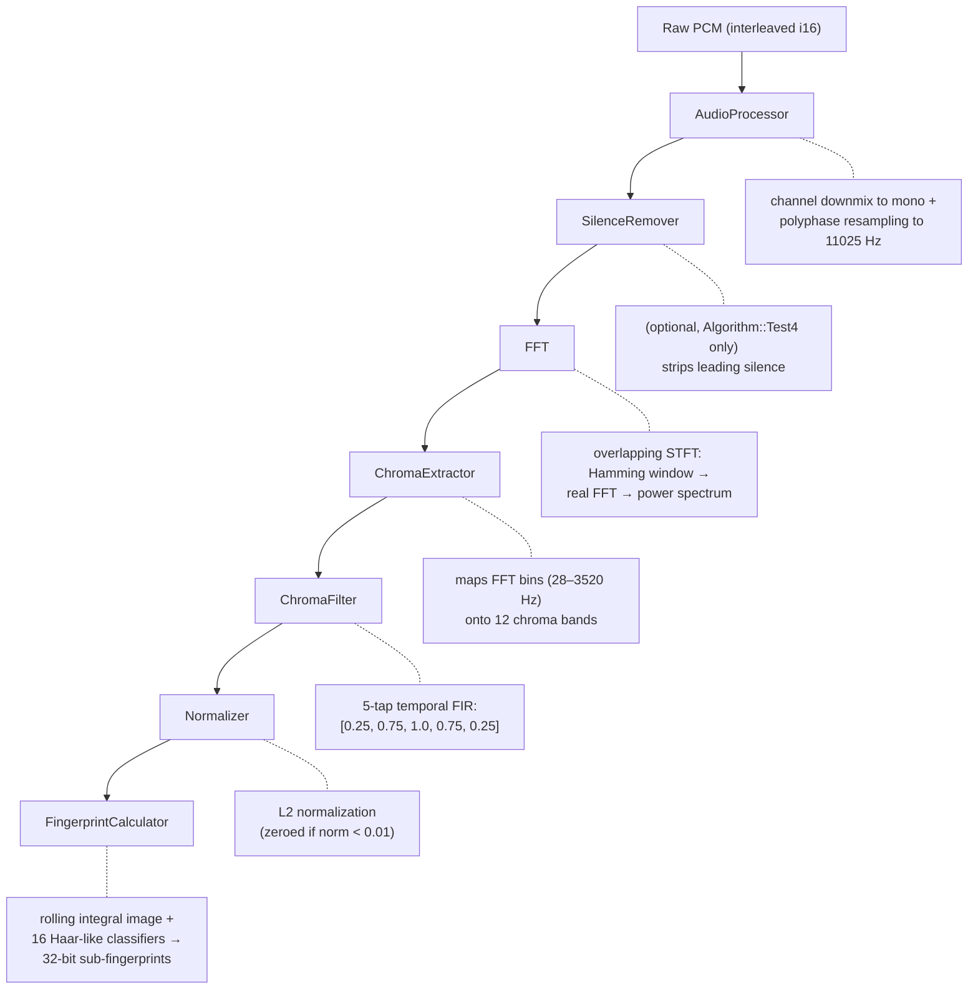

# Implementation overview

chromaprint-next is a pure-Rust port of the [C/C++ Chromaprint library](https://github.com/acoustid/chromaprint), producing **bit-identical fingerprints** for all five algorithm variants (TEST1 through TEST5) when given the same PCM input. This is verified by the `chromaprint-test-suite` workspace crate, which links both the C library (via FFI) and the Rust crate, feeding identical audio through both and asserting equality of raw fingerprints, compressed base64 strings, and SimHash values.

When updating the C reference implementation, re-run the cross-implementation test suite (`cargo test -p chromaprint-test-suite`) and check that all tests still pass.

## Pipeline architecture

Both implementations follow the same linear, push-based pipeline:

Each stage is matched component-by-component against the C implementation.

## How each stage matches the reference

### Resampler

The C library bundles FFmpeg's `av_resample` polyphase FIR resampler (`avresample/resample2.c`). The Rust port (`audio/resample.rs`) is a direct translation of this code: Kaiser-windowed sinc filter (beta=9), 16 taps, 256 phases, fixed-point i16 arithmetic with 15-bit shift, identical filter bank construction and rational-arithmetic output stepping. The startup transient handling (cyclic reflection for negative indices) and saturation clamping logic are reproduced exactly.

### Audio processor

Channel mixing uses integer averaging (`(L+R)/2` for stereo, `sum/N` for multi-channel). The 32 KiB accumulation buffer, resampling trigger, and unconsumed-sample preservation all match the C `AudioProcessor` behavior.

### FFT

The C library uses vDSP (Apple Accelerate) on macOS with a Hamming window scaled by `0.5 / INT16_MAX` to compensate for vDSP's 2x output convention. The Rust port (`fft/real.rs`) computes the real FFT the way the `realfft` crate does — a half-length `rustfft` complex FFT followed by a twiddle pass — with a window scale of `1.0 / 32768.0`, and fuses the twiddle pass with the power spectrum. Its output is bit-identical to `realfft` followed by `re² + im²`, which a test checks against the `realfft` crate. Since this follows the standard DFT convention (no 2x factor), the net sample scaling is equivalent: both produce `|DFT(sample * hamming / ~32768)|^2` as the power spectrum. Frame slicing uses interleaved write-and-process on a ring buffer to avoid overflow regardless of input chunk size.

### Chroma extraction

Frequency-to-note mapping uses `f64` arithmetic throughout, matching the C implementation's `double` precision. The `(char)note` truncation in C (signed i8 cast) is replicated as `(note as i8) as u8`. The precomputed `notes[]` and `notes_frac[]` lookup tables are identical.

### Chroma filter, normalizer, integral image, classifiers, quantizer

All operate in `f64` precision, matching the C `double` / `std::vector<double>` types used through this entire portion of the pipeline. The quantizer uses the same branching threshold structure as C. Classifier outputs are Gray-coded identically (`[0, 1, 3, 2]`).

### Encoding, decoding, SimHash

The fingerprint compressor uses the same dual-stream delta encoding (3-bit normal gaps + 5-bit exceptional overflows) with URL-safe base64 (alphabet `A-Za-z0-9-_`, no padding). The decompressor and SimHash (per-bit majority voting) are also direct ports.

## Algorithm configurations

| Algorithm | Frame Size | Frame Overlap | Classifiers | Silence Removal |
|-----------|-----------|---------------|-------------|-----------------|
| Test1     | 4096      | 2731          | 16 unique   | No              |
| Test2     | 4096      | 2731          | 16 unique   | No              |
| Test3     | 4096      | 0 (see bugs)  | Same as Test2 | No            |
| Test4     | 4096      | 2731          | Same as Test2 | Yes (threshold=50) |
| Test5     | 2048      | 1024          | Same as Test2 | No              |

Test2 is the default algorithm (`CHROMAPRINT_ALGORITHM_DEFAULT`).

---

## Performance characteristics

### Memory

All pipeline buffers are pre-allocated at construction. The hot path (per-sample processing) performs **zero heap allocations**. The only growing allocation is `Vec<u32>` in `FingerprintCalculator`, which appends one `u32` per ~124 ms of audio (one per frame hop at 11025 Hz with the default 1365-sample increment).

Fixed allocations at construction:

| Component | Buffer | Size |
|-----------|--------|------|
| AudioProcessor | input accumulator | 64 KiB (32768 × i16) |
| AudioProcessor | resample output | 64 KiB (32768 × i16) |
| Resampler | polyphase filter bank | ~40 KiB for 44100→11025 Hz (80 taps × 257 phases × i16), shared by all streams with the same rates |
| FftProcessor | ring buffer | 4 × frame_size × 2 bytes (32 KiB for default) |
| FftProcessor | FFT workspace | ~3 × frame_size (f32 + Complex) |
| ChromaExtractor | note lookup tables | 2 × frame_size (u8 + f64) |
| ChromaFilter | frame buffer | 768 bytes inline (8 × 12 × f64) |
| RollingIntegralImage | summed area table | ~24 KiB (257 × 12 × f64) |

Total working memory is approximately **250 KiB** for the default configuration (44100 Hz input), independent of audio length. The resampler filter bank size varies with the input-to-output sample rate ratio — higher ratios require longer filters. Filter banks are kept in a process-wide cache of up to 16 rate pairs, so streams after the first skip the ~0.6 ms bank construction; rates beyond the cache's capacity get a bank of their own as before.

### Computation

The pipeline is **single-threaded** and fully synchronous. Each stage invokes the next via `FnMut` closures, keeping the call chain tight with no synchronization overhead.

The two dominant costs are the resampler (~38% of time) and the half-length complex FFT (`rustfft`, ~33%). For the default 4096-sample frame, the FFT is O(N log N) = ~49K multiply-adds. The Haar filter classifiers are O(1) per classifier (4 lookups in the integral image), so all 16 classifiers cost a fixed 64 lookups per frame.

Explicit SIMD (`simd` module: NEON on aarch64, SSE2 on x86/x86_64, scalar elsewhere) covers the resampler dot products, stereo downmix, FFT windowing, and the real-FFT twiddle pass fused with the power spectrum. Each kernel is tested bit-exact against its scalar version; floating-point kernels use plain multiplies and adds in the scalar order, never fused multiply-add. Other inner loops (chroma accumulation, integral image row updates) rely on LLVM. See [benchmarks](benchmarks.md#optimisations-applied) for the full list.

### Parallelism

The optional `parallel` feature (gated behind the `rayon` dependency) provides `fingerprint_batch`, which processes multiple independent audio buffers concurrently via `rayon::par_iter`. Each task creates its own `Fingerprinter` with no shared mutable state, so there is no contention or locking.

### Arithmetic precision

| Pipeline stage | Precision | Rationale |
|---------------|-----------|-----------|
| Resampler | i16 fixed-point (15-bit shift) | Exact match with C's `av_resample` |
| FFT | f32 | Sufficient for spectral analysis; `rustfft`'s native type |
| Chroma extraction onward | f64 | Matches C's `double` throughout; prevents classifier threshold boundary rounding errors |

The f64 precision in the downstream pipeline is critical for exact fingerprint matching. With f32, accumulated rounding differences in the integral image can push classifier decisions across quantizer thresholds, producing different 2-bit codes. This was observed empirically with Algorithm Test5 (frame_size=2048), where the smaller frame size shifts FFT bin boundaries enough to amplify f32 vs f64 divergence.

---

## Known bugs

The Rust port deliberately reproduces two bugs present in the C library's Test3 algorithm to ensure fingerprint-identical output. See [known-bugs.md](known-bugs.md) for details.
